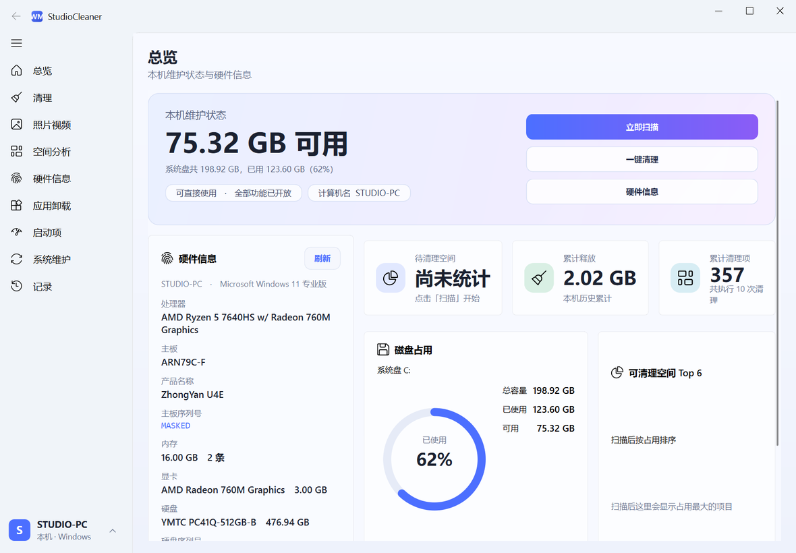
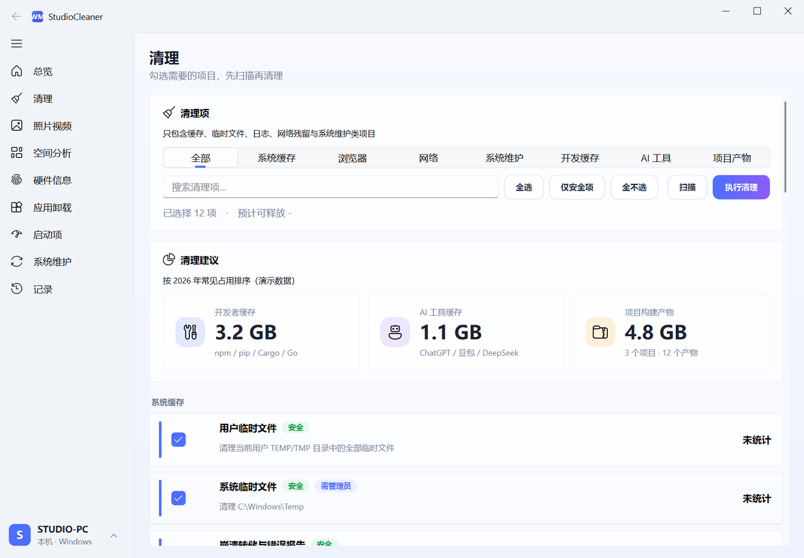
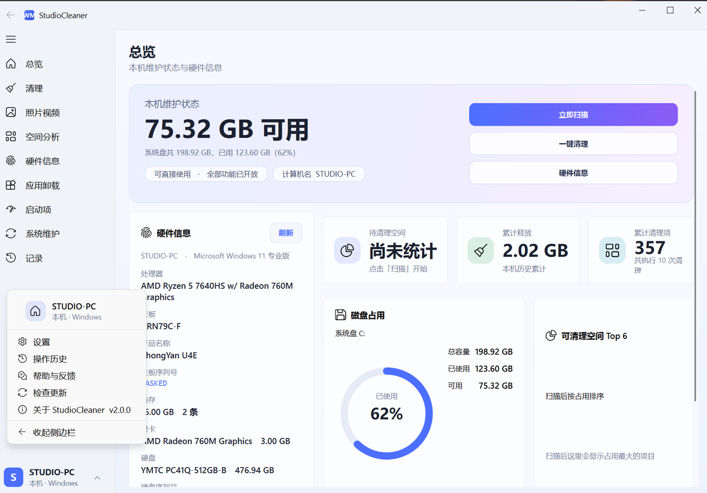
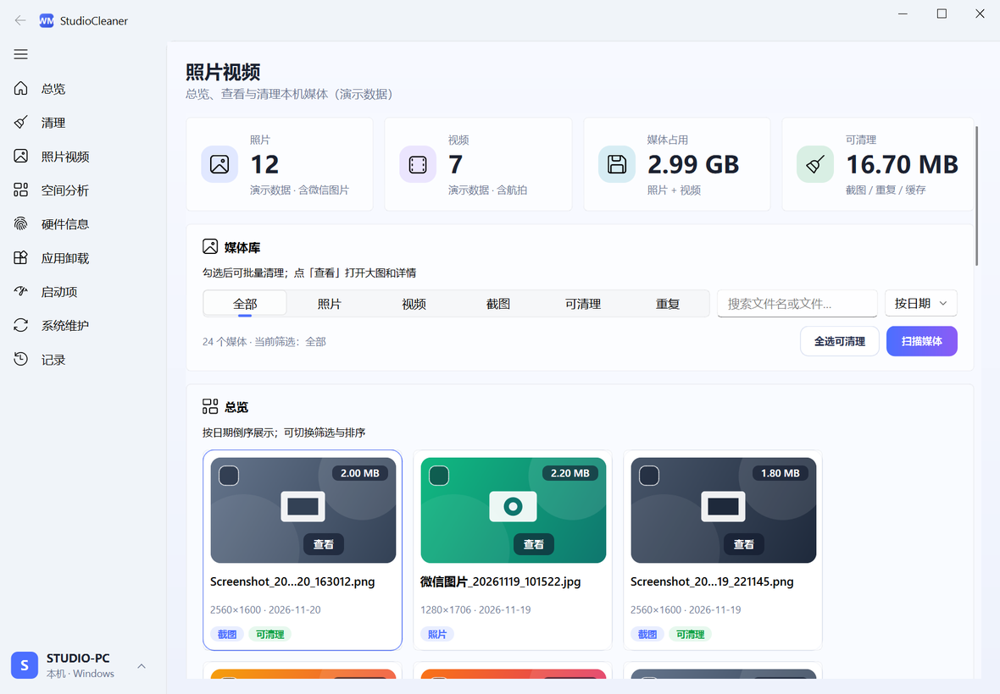
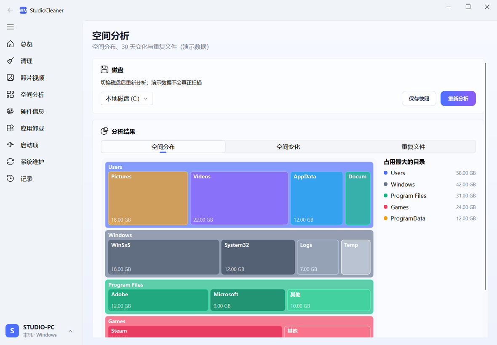
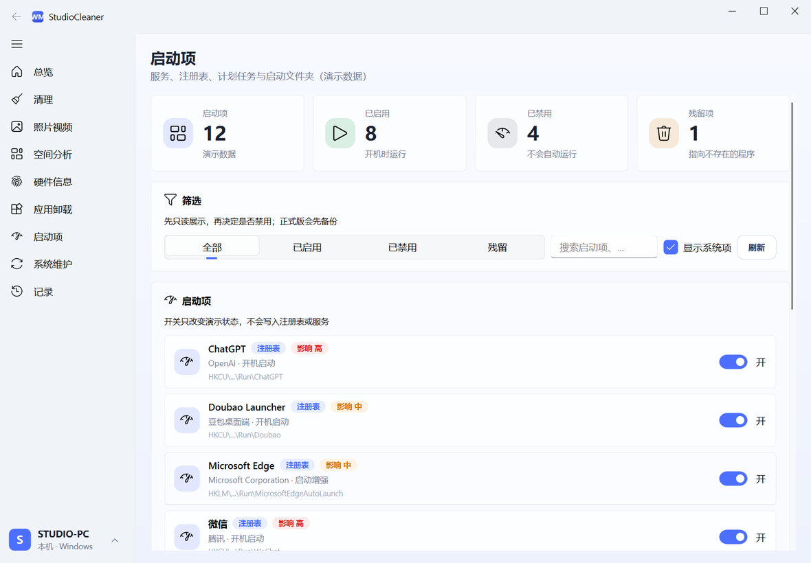
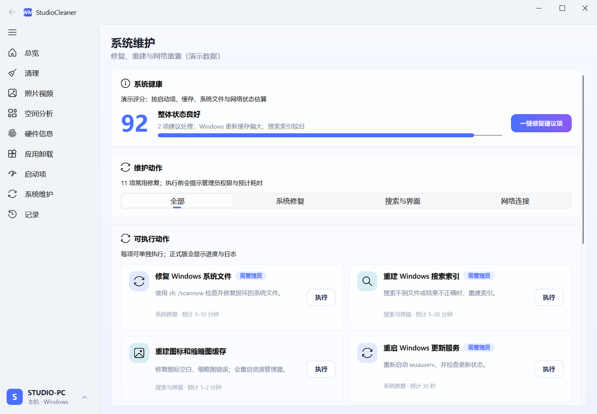
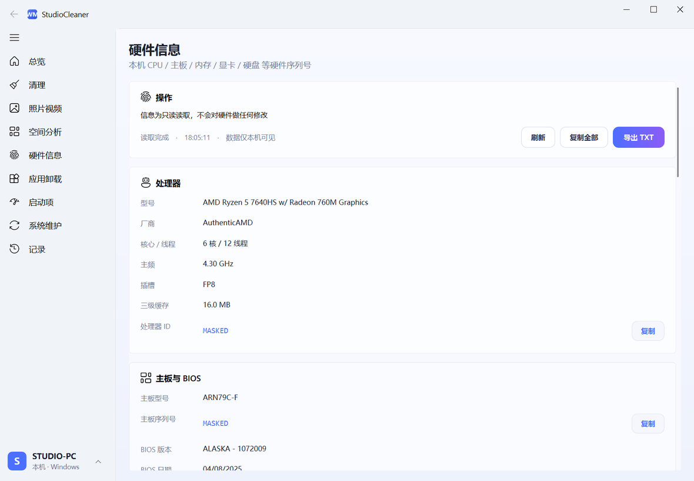

<div align="center">
  
  <h1>StudioCleaner</h1>
  <p>开源 Windows 系统清理与维护工具 · PySide6 + Fluent Design</p>
  <p>
    
    
    
    
  </p>
</div>



StudioCleaner 是一个本地优先的 Windows 清理工具：不用登录、不联网、不上传任何文件。
界面基于 PySide6 与 PySide6-Fluent-Widgets，单文件 exe 打开即用。

如果这个项目对你有用，点个 **Star** ⭐ 就是最大的支持。

---

## 功能

| 模块 | 说明 | 状态 |
| --- | --- | --- |
| 总览 | 磁盘占用、可清理空间、历史释放统计、硬件信息常驻面板 | ✅ 可用 |
| 清理 | 系统缓存 / 浏览器 / 网络 / 系统维护 / 开发缓存 / AI 工具 / 项目产物，共 20+ 项，逐项开关 | ✅ 可用 |
| 硬件信息 | CPU、主板与 BIOS、内存条、显卡、硬盘、网卡、系统；序列号只读展示，可复制/导出 TXT | ✅ 可用 |
| 应用卸载 | 读取三家注册表卸载项，搜索/排序，调用自带卸载程序，残留扫描与注册表备份 | ✅ 可用 |
| 照片视频 | 缩略图网格、筛选、查看、批量清理 | 🧪 界面演示 |
| 空间分析 | 空间分布、30 天变化、重复文件分组 | 🧪 界面演示 |
| 启动项 | 服务 / 注册表 / 计划任务 / 启动文件夹，启用禁用开关 | 🧪 界面演示 |
| 系统维护 | SFC、DISM、搜索索引、打印队列、DNS 等 11 项修复入口 | 🧪 界面演示 |
| 记录 | 每次清理的结果与释放空间，可导出 CSV | ✅ 可用 |
| 主题 | 浅色 / 深色 / 跟随系统 | ✅ 可用 |

> **诚实说明**：标有「界面演示」的页面目前只完成交互与视觉，不会真实扫描或修改系统。
> 清理、卸载、硬件读取是真实功能；演示页不会删除文件、不写注册表。

### 界面

| 清理 | 左下角用户菜单 |
| --- | --- |
|  |  |

| 照片视频 | 空间分析 |
| --- | --- |
|  |  |

| 启动项 | 系统维护 |
| --- | --- |
|  |  |



---

## 下载与运行

到 [Releases](../../releases) 下载 `StudioCleaner.exe`，双击运行。单文件，无需安装 Python 或其它依赖。

首次启动约 3-5 秒（单文件会解压 Qt 运行库到临时目录），之后会快很多。

系统要求：Windows 10 1709+ / Windows 11。读取硬件信息建议以管理员身份运行；清理系统级目录时同样需要管理员权限。

---

## 从源码运行

```bat
python -m venv .venv
.venv\Scripts\pip install -r requirements.txt
.venv\Scripts\python main.py
```

自检（会生成 `selftest.txt` 到数据目录）：

```bat
.venv\Scripts\python main.py --selftest
```

## 打包单文件 exe

```bat
.venv\Scripts\pip install pyinstaller
.venv\Scripts\python -m PyInstaller --noconfirm --clean StudioCleaner.spec
```

产物：`dist\StudioCleaner.exe`。

> 打包配置里排除了第三方 ICU DLL。Qt6Core 依赖 Windows 自带的免版本号 ICU；
> 如果从 PATH 误打包 poppler 等目录下的 `icuuc.dll`，启动会报
> `DLL load failed while importing QtGui`。`StudioCleaner.spec` 已处理。

---

## 安全设计

- **删除白名单**：所有文件删除前校验目标位于允许的根目录内
- **不跟随链接**：遍历时跳过符号链接与联接点
- **占用即跳过**：文件被占用时计入「跳过」，不中断整批任务
- **注册表先备份**：删除启动项 / 卸载残留前自动 `reg export`
- **默认保守**：高危项默认不勾选，执行前二次确认
- **权限检测**：非管理员时明确标注并跳过，不静默失败
- **完全本地**：没有账号、没有遥测、不上传文件

### 明确不做

本工具不包含设备身份改写或取证痕迹擦除：EDID / 序列号改写、显卡 UUID 改写、
设备枚举历史删除、内核即插即用日志清除、反作弊残留清理、DMA / KVM / 宏盒痕迹清理。
硬件信息页只读展示，不提供修改入口。

---

## 项目结构

```text
StudioCleaner/
├─ app/
│  ├─ core/          清理引擎、硬件采集、卸载、PDF、进程检测
│  ├─ data/          SQLite 存储与机器信息
│  ├─ ui/
│  │  ├─ pages/      总览 / 清理 / 照片视频 / 空间 / 硬件 / 卸载 / 启动项 / 维护 / 记录 / 设置
│  │  └─ widgets/    卡片、环形图、条形图、硬件面板等
│  ├─ state.py       全局状态
│  └─ main.py        入口
├─ docs/screenshots/ 界面截图
├─ main.py           启动脚本
├─ StudioCleaner.spec
├─ build.bat
└─ requirements.txt
```

数据保存在 `%LOCALAPPDATA%\StudioCleaner`：清理历史、设置、注册表备份、错误日志。

---

## Roadmap

- [ ] 照片视频：真实缩略图扫描与重复检测
- [ ] 空间分析：真实目录 treemap 与 30 天快照
- [ ] 启动项：真实启用/禁用（含计划任务）
- [ ] 系统维护：接入 SFC / DISM 并回显进度
- [ ] 定时清理与静默部署参数

欢迎在 Issues 里提需求和 bug，附上「关于」页的一键诊断信息会更容易定位。

## 贡献

1. Fork 并创建分支
2. 保持改动最小、可回滚
3. 提交前跑一遍 `python main.py --selftest`
4. 发 PR，说明改了什么、怎么验证

## License

[MIT](LICENSE)